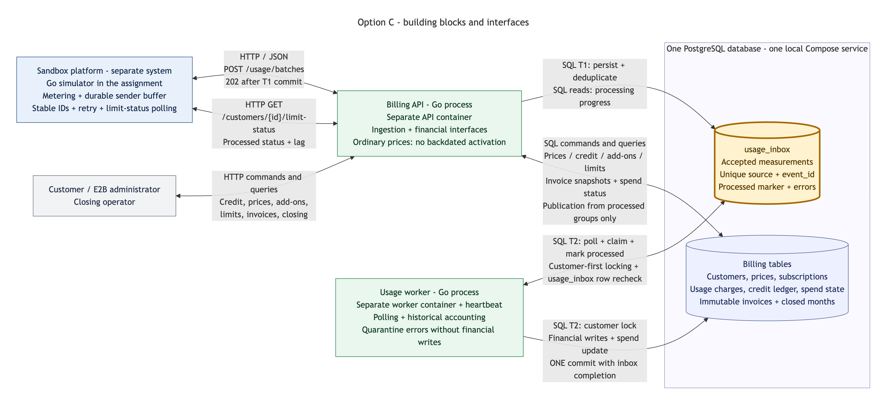

# E2B Billing API

## Disclaimer — proof of concept

This is a proof of concept for the E2B assignment, intended for local demonstration
and technical review. Production deployment requires further operational
specification, validation, and hardening; production capacity has not been established.

[Known limitations and investigation plans](docs/architecture/limitations.md)
describe delayed limit visibility, deferred invoicing, and rounding across invoices,
including what to measure and when mitigation is needed.

## Overview

A billing service built with Go and PostgreSQL. It implements durable usage
receipt and asynchronous transactional accounting, historical default and
customer prices, exact usage-only credit, recurring add-ons, gross monthly spend
limits, and numbered, immutable monthly invoices. A separate, restartable Go
simulator exercises delivery failures, retries, and the public billing workflows.
Unit, SQL integrity, HTTP integration, and complete workflow tests cover the solution.

The scope is monthly billing in UTC. Each receipt must fit one UTC month and one
applicable price version; invoices are issued explicitly through the API.
Authentication, automatic invoice scheduling, and invoice delivery remain outside
the implementation. The [implementation overview](docs/architecture/submission-overview.md)
describes assignment coverage, responsibility boundaries, and remaining limitations.

### Architecture

The selected [option C](docs/brainstorming/architecture-options.md#why-option-c-was-selected)
uses an HTTP API, a PostgreSQL inbox, and an independent accounting worker.
The API acknowledges committed input; the worker commits each receipt's financial
effects and completion together. Invoice issuance snapshots already processed usage.



[Architecture guide](docs/architecture/submission-overview.md) ·
[Diagram explanation and Mermaid source](docs/diagrams/option-c-components/README.md).

## Quick start

Requirements: Docker with Docker Compose and Make. Go and PostgreSQL clients run
inside containers. Run commands from the repository root; optionally copy
[.env.example](.env.example) to `.env` to change local ports or settings.

```sh
git clone https://github.com/pupitooo/e2b-billing-api.git
cd e2b-billing-api
make up SERVICE=postgres
make migrate
make up
make links
```

Migrations are explicit, including on existing volumes; startup never applies them.
The simulator waits for an explicit command before producing usage. Use the same
Compose project and configuration throughout; see [local setup](docs/guides/local-development.md)
for isolated environments and service operations.

## Documentation and tools

Open the **Documentation portal** link printed by `make links`, by default
[http://127.0.0.1:8082/](http://127.0.0.1:8082/). The searchable portal contains
setup, operations, API contracts and examples, financial rules, simulator scenarios,
testing, development conventions, and architecture.

To start the portal and browser tools separately:

```sh
make docs
```

This also starts the API, PostgreSQL, and Adminer; migrations and worker startup
remain explicit. Follow [local setup](docs/guides/local-development.md) when you
also want usage to be accounted. Printed addresses follow your configured ports.

| Tool | Purpose | Default access |
| --- | --- | --- |
| Documentation portal | Search and browse all published guides and diagrams. | [Guides](http://127.0.0.1:8082/) |
| Scalar | Browse the OpenAPI reference and send API requests. | [API reference and request client](http://127.0.0.1:8082/reference/) |
| Billing demo GUI | Inspect accounts, run billing commands, retry requests, and walk through the assignment. | [Demo console](http://127.0.0.1:8082/demo/) |
| Adminer | Inspect PostgreSQL data and run SQL manually. | [Database browser](http://127.0.0.1:8082/database/) |
| Go simulator | Run repeatable transport and billing scenarios with durable checkpoints. | `make simulate-help`; [scenario guide](docs/simulator/billing-scenarios.md) |

Use an [isolated assignment environment](docs/simulator/billing-scenarios.md#start-an-isolated-assignment-environment)
for experiments that change billing data. The assignment walkthrough has calendar
and receipt-time prerequisites, explained in that guide.

### Repository entry points

Before the portal is running, the same guides are readable directly in the repository:

For a past-month invoice with multiple usage prices and an add-on, use the
[fixed-clock demo](docs/guides/demo-console.md#fixed-clock-invoice-demo).

| Topic | Start here |
| --- | --- |
| All documentation | [Documentation index](docs/index.md) |
| Setup and operations | [Local setup](docs/guides/local-development.md), [troubleshooting](docs/guides/troubleshooting.md) |
| API requests | [API guide](docs/guides/api-reference.md), [OpenAPI specification](docs/api/openapi.yaml) |
| Billing and architecture | [Implementation overview](docs/architecture/submission-overview.md), [system contracts](docs/architecture/system-contracts.md), [usage to invoice](docs/architecture/usage-to-invoice.md) |
| Scenarios and verification | [Billing scenarios](docs/simulator/billing-scenarios.md), [tests](docs/guides/testing.md), [acceptance procedure](docs/guides/final-acceptance-testing.md) |
| Development | [Conventions](docs/guides/development.md), [documentation maintenance](docs/guides/documentation.md) |
