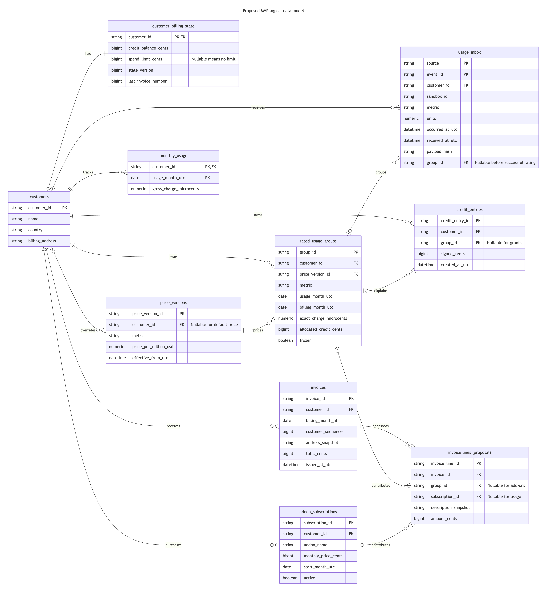
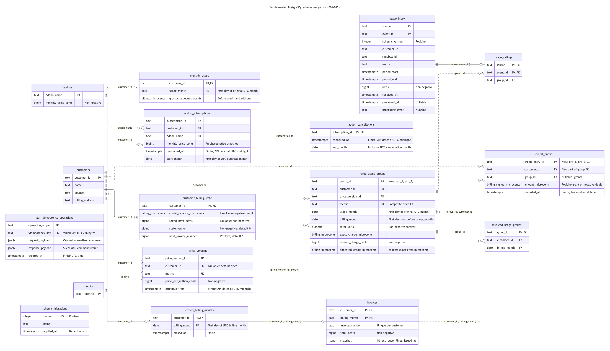

# Data model

This page describes the logical model, implemented PostgreSQL tables and
relationships, seed catalog, and stored identities.

- [Logical model](#logical-data-model-erd) introduces the billing entities.
- [Implemented schema](#implemented-postgresql-schema-erd-migrations-001013) and
  [tables](#tables-and-relationships) describe SQL storage.
- [Initial data](#initial-data-and-migrations) identifies the assignment seed.
- [Command identities](#durable-api-operation-keys) and
  [accounting IDs](#sequential-accounting-ids) describe persistent identity.

For calculations and calendar policies, read [financial rules](accounting-rules.md).
Follow [usage to invoice](usage-to-invoice.md) for the worked accounting flow,
[architecture decisions](decisions.md) for rationale and trade-offs, and
[migrations](../guides/migrations.md) for operational schema changes.

## Logical data model (ERD)

The logical model introduces customers, metered usage, historical prices, credit, add-on purchases, and monthly invoices before considering SQL tables and constraints. The diagram shows the main billing concepts and their relationships; the implementation sections below describe their PostgreSQL representation. Invoice lines and immutable monthly invoices are explained in the [usage-to-invoice guide](usage-to-invoice.md#8-invoiceline-what-appears-on-a-particular-invoice).

[Editable Mermaid source](../diagrams/data-model/data-model.mmd).

Conceptually, accepted usage is rated using historical prices, consumes available usage credit, and contributes to a monthly invoice alongside purchased add-ons. The architectural decisions below explain how these responsibilities map to durable input, financial state, and immutable output.

## Implemented PostgreSQL schema (ERD, migrations 001–013)

`UsageReceipt` maps to `usage_inbox` plus the separate `usage_ratings` link. Invoices use immutable JSON snapshots and frozen-group links rather than the separate line table proposed in the logical ERD.

This diagram shows all 17 tables and their SQL columns, primary keys, foreign keys, and relationship cardinalities after migrations `001` through `013`, including the runner's `schema_migrations` table. It uses the names and types from the migrations and includes closure, command history, invoice snapshots, and frozen-group links.

[Open full-size PNG](../diagrams/implemented-data-model/implemented-data-model.png) · [Editable Mermaid source](../diagrams/implemented-data-model/implemented-data-model.mmd).

All columns are `NOT NULL` unless labeled nullable. `PK` and `FK` mark columns belonging to primary and foreign keys, including composite keys. Solid relationships include the referenced identity in the child's primary key; dashed relationships are other declared foreign keys. The Mermaid source records the composite unique constraints. `billing_microcents` is an exact `numeric` domain for non-negative finite integer amounts in microcents; one cent is 1_000_000 microcents. Columns ending in `_microcents` contain microcents; the signed ledger uses `billing_signed_microcents`.

`usage_inbox` has no customer or metric foreign keys. Its optional one-to-one relationship with `usage_ratings` records whether an event has been assigned to a group; each rating references one `rated_usage_groups` row. The diagram shows database cardinalities, so a customer may have zero or one account-state row even though the seed creates one for each initial customer. Receipt matching and price ownership checks are enforced by triggers, as described below.

`invoices` references a closed customer/month; `invoiced_usage_groups` links each group to at most one invoice and activates the group-freeze trigger. Buyer details, issue time and lines live in the immutable JSON snapshot. Migration 009 retires the three pending-usage closing tables; the worker and closing coordinate through the existing account lock and committed closed months.

## Tables and relationships

| Table | Purpose and relationships |
| --- | --- |
| `customers` | Customer identity, name, country, and current billing address. |
| `customer_billing_state` | One account row per customer with exact credit balance, optional spend limit, state version, and next invoice number. Financial writers serialize on this row. |
| `metrics` | Supported metering identifiers. |
| `api_idempotency_operations` | Append-only scoped request keys, normalized original inputs, successful resource results, and creation times. Written atomically with prices, subscriptions, credit grants, and spend-limit changes; keys are retained indefinitely. |
| `price_versions` | Historical prices for a metric, either a default (`customer_id IS NULL`) or a customer override. Each version stores an explicit effective instant; new API versions use midnight UTC on the supplied calendar date. |
| `rated_usage_groups` | Totals grouped by customer, price version, original usage month, and billing month; stores exact units/gross microcents, booked gross cents, and allocated credit microcents. |
| `usage_ratings` | Links one `(source, event_id)` from `usage_inbox` to exactly one group. Many events can share a group. |
| `monthly_usage` | Gross usage charges in exact microcents per customer and original UTC month, before credit and add-ons. |
| `credit_entries` | Exact signed microcent history: positive grants without a group and negative usage debits referencing a group owned by the same customer. Server-generated `credit_entry_id` identifies each row; API keys live in the shared command history. Usage effects commit with the unique event rating and receipt checkpoint. |
| `addons` | Add-on catalog and monthly price in cents. |
| `addon_subscriptions` | Customer purchases with a monthly price snapshot and the UTC purchase month. Purchase periods are append-only, with no overlapping active months for one customer/add-on. Later purchases retain earlier IDs and snapshots. |
| `addon_cancellations` | Append-only termination per purchase; `end_month` is its inclusive final charged UTC month. The period trigger shares the customer lock with financial commands. |
| `closed_billing_months` | Immutable customer/month closures used to route late consumption forward. |
| `invoices` | One immutable snapshot per customer/month, with unique per-customer number and total cents. Buyer details, ordered lines, exact audit microcents, and issue time are in `snapshot`. |
| `invoiced_usage_groups` | Links issued invoices to groups; a trigger rejects changes to frozen groups. |

Identifiers, balances, prices, and timestamps are supplied explicitly. `customer_billing_state.state_version` defaults to zero and `next_invoice_number` to one for new accounts; callers may supply explicit initial values. Version increments and text validation remain application responsibilities. The inbox remains independent of the catalog: ingestion can preserve unknown customers or metrics for an explicit processing error rather than losing the input.

Foreign keys reject missing catalog records, missing receipts, and credit debits for another customer's group. A group's price must belong to its metric and be either a default or an override for that customer. Group identity cannot change after insertion; totals can increase as the worker processes more events. Rating links require the same customer and metric and an interval wholly within the original UTC month, including intervals ending exactly at the next month's boundary.

Prices, credit entries, rating links, add-on purchases and cancellations reject row updates and deletes. Price changes append a new version; they do not rewrite past prices. Customer details, account projections, group totals, monthly totals, and the add-on catalog remain mutable. A subscription retains its purchased price when the catalog changes.
## Initial data and migrations

Apply the schema and seed using the [migration procedure](../guides/migrations.md#database-migrations).

Migration `002_billing_model.sql` creates the model. Migration `003_assignment_seed.sql` loads the assignment's initial data:

| Item | Initial values |
| --- | --- |
| Acme | `acme`, Acme Inc., US, 1 Market St, San Francisco, CA 94105 |
| Cyberdyne | `cyberdyne`, Cyberdyne Systems Corporation, US, 18144 El Camino Real, Sunnyvale, CA 94087 |
| Metric | `cpu_seconds` |
| Default price | 5 cents per million from `2026-10-01T00:00:00Z` |
| Default price | 6 cents per million from `2026-10-15T00:00:00Z` |
| Acme override | 4 cents per million from `2026-10-01T00:00:00Z` |
| Add-on | `concurrency_pack`, 2_000 cents per month |

Both accounts start with zero credit, no spend limit, and state version zero. The example's USD 25 grant, purchase, USD 15 limit, metering events, and invoices are business actions performed by public APIs and the billing simulator, rather than initial catalog data. No financial history or usage is seeded.

Migration `004_exact_credit.sql` converts existing cent credit values to microcents without rewriting migration 002 or its seed. It adds the finite signed-integer domain `billing_signed_microcents` for ledger amounts. See the [conversion and legacy-allocation limitation](../guides/migrations.md#migration-and-verification).

The migration runner applies schema, seed, and version records in one transaction under the existing advisory lock. On an existing volume it applies only pending versions. Repeated runs skip the seed, preserving changed account state and customer details. A seed error rolls back the model migration and its version record too.

Migration `013_addon_cancellations.sql` preserves existing purchases and invoices, adds append-only terminations and replaces lifetime customer/add-on uniqueness with nonoverlapping purchase months. See [upgrade instructions](../guides/migrations.md#add-on-lifecycle-upgrade).

## Durable API operation keys

Migration `010_api_idempotency.sql` creates append-only
`api_idempotency_operations` for prices, add-ons, credit grants, and spend-limit
changes. All caller keys use the column name `idempotency_key`. Credit entries
contain only server-generated ledger IDs and financial data; there is no separate
spend-limit history table. The shared history stores the original input and result,
including the internal ledger ID of a credit grant.

Successful keys and results are retained indefinitely. They commit in the same
transaction as their financial resource, so retry needs no in-memory API state.

## Sequential accounting IDs

Migration `012_accounting_id_sequences.sql` adds persistent, noncycling sequences
for new `grp_<number>` and `crd_<number>` IDs. Apply `make migrate` before starting
the updated API and worker. Existing group IDs, ledger entries, references and
issued invoices retain their original values. Each sequence starts at one unless
earlier canonical decimal IDs reserve numbers. Allocation may leave gaps after
rollback; do not reset or cycle these sequences.
