# Concurrency and locking sequences

Billing preserves financial ordering with PostgreSQL transaction locks. Two operations for the same customer wait on the same account row; price changes coordinate with rating through a separate catalog lock. usage_inbox row retries and command retries have different identities and locks. This guide shows the implemented competing operations, the wait points and the result when either operation wins.

The sequences cover every explicit lock site in first-party application code, the migration runner, the add-on integrity triggers and the controlled repair procedure. The final section also covers the API's admission semaphore. Automatic invoice scheduling and Kafka processing are proposals and are outside these implemented lock sequences. For the successful overall data path, use [usage to invoice](processing-sequences.md).

## Reading the sequences

Use the [approved billing vocabulary](../guides/billing-vocabulary.md). The graphs name the row selector as `table.column`. For example, `customer_billing_state.customer_id = C` selects the whole customer row, and `(usage_inbox.source, usage_inbox.event_id) = (S, E)` selects one stored event. The row itself is locked, not an individual balance cell. Catalog and request advisory locks identify resources and command identities; they are not locks on those tables' columns.

Each lane represents an independent request, worker transaction or command. `WAIT` means the database has not returned from the requested lock; the lock owner continues until commit or rollback. An `alt` branch begins from its own initial state. The branch order illustrates possible winners, not a scheduling or fairness guarantee. Open a PNG at full size for table and lock names.

`FOR UPDATE` is an exclusive row lock. The catalog's shared advisory lock allows multiple raters; its exclusive version waits for those raters and excludes new holders while held. All PostgreSQL locks drawn here last until their transaction ends. The simulator's file lock instead lasts for the owning file descriptor and rejects contention immediately.

## Lock inventory and operation coverage

| Resource | Acquisition and scope | Operations that use it |
| --- | --- | --- |
| Customer account | `customer_billing_state FOR UPDATE`, one customer row | Worker accounting, credit grants, spend-limit changes, add-on purchase and cancellation, monthly closing, invoice catch-up, controlled catalog repair and both add-on period triggers. |
| Price catalog | Advisory pair `(65_102, 2)`, one database-wide resource | Worker: shared. Ordinary price creation and historical SQL repair: exclusive. Unrelated customer or metric price changes still use this same catalog lock. |
| Financial command identity | Advisory namespace `65_103` plus `hashtext(JSON([scope, key]))` | Prices, credits, spend limits, purchases, cancellations and catch-up. Exact identity is the primary key in `api_idempotency_operations`; a hash collision can introduce waiting without merging command identities. |
| usage_inbox row identity and row | Unique `(source, event_id)` insertion; existing-content `FOR SHARE`; worker pending-usage_inbox row `FOR UPDATE` | `POST /usage/batches` and worker processing. Input keys are sorted before batch insertion; arrival time is preserved on identical replay. |
| Migration runner | Advisory pair `(65_102, 1)`, one database-wide resource | `migrations/migrate.sql`, including simultaneous fresh and repeated runners. This differs from catalog key 2. |
| Simulator checkpoint | `flock(LOCK_EX \| LOCK_NB)` on `<state>.lock` | All transport and financial workflow commands using that state path. The second owner fails immediately; distinct paths have separate locks. |
| Usage admission capacity | A buffered channel, shared by one usage handler | Simultaneous usage HTTP requests in one API process. This is a semaphore, not the source of database financial ordering. |

| Operation | Lock acquisition order for a new effect | Relevant sequences |
| --- | --- | --- |
| `InsertBatch` / `POST /usage/batches` | Admission slot → sorted usage_inbox row-key inserts → existing-row share locks when needed. No account or catalog lock. | [Competing batches](#competing-usage-inbox-batches), [usage_inbox row versus worker](#usage_inbox-row-replay-versus-worker-completion), [admission](#api-admission-capacity). |
| `ProcessBatch` | Select candidate outside transaction → account → shared catalog → pending usage_inbox row. | [Workers](#two-workers), [closing](#worker-versus-monthly-closing), [prices](#price-insertion-versus-rating), [credit](#credit-grant-versus-rating), [repair](#historical-catalog-repair). |
| `CreatePrice` / `POST /prices` | Scoped request → exclusive catalog. The server UTC day is sampled after locking and replay checks. No account lock. | [Command replay](#financial-command-replay), [prices](#price-insertion-versus-rating). |
| `GrantCredit` / `POST /customers/{id}/credits` | Scoped request → account. | [Command replay](#financial-command-replay), [credit](#credit-grant-versus-rating). |
| `SetSpendLimit` / `POST /customers/{id}/spend-limit` | Scoped request → account. | [Command replay](#financial-command-replay), [limits and reads](#spend-limit-writes-and-status-reads). |
| `PurchaseAddon` / `POST /customers/{id}/addons` | Scoped request → account; insertion trigger reuses the account lock. | [Purchase versus closing](#add-on-purchase-versus-closing), [reactivation](#add-on-cancellation-and-reactivation), [command replay](#financial-command-replay). |
| `CancelAddon` / `POST /customers/{id}/addons/cancel` | Scoped request → account; insertion trigger reuses the account lock. | [Cancellation](#add-on-cancellation-and-reactivation), [command replay](#financial-command-replay). |
| `CloseMonth` / `POST /customers/{id}/invoices` | Account. Retry identity is customer and month, with no request-key advisory lock. | [Worker versus closing](#worker-versus-monthly-closing), [concurrent closes](#concurrent-monthly-closing), [add-ons](#add-on-purchase-versus-closing), [catch-up](#catch-up-versus-worker-and-single-month-closing). |
| `CatchUpInvoices` / `POST /customers/{id}/invoices/catch-up` | Scoped request → account, held through every month in the range. | [Catch-up](#catch-up-versus-worker-and-single-month-closing), [command replay](#financial-command-replay). |
| Controlled historical SQL repair | Account → exclusive catalog → released usage_inbox row update. | [Repair](#historical-catalog-repair). |
| Direct subscription or cancellation insert | Trigger takes the owning account lock before checking its period invariant. No API request-history entry or API version increment is supplied by the trigger itself. | [Purchase](#add-on-purchase-versus-closing), [cancellation](#add-on-cancellation-and-reactivation). |
| Migration runner / simulator command | Dedicated migration advisory lock / dedicated checkpoint file lock. | [Migrations](#concurrent-migration-runners), [simulator](#simulator-checkpoint-ownership). |

Ordinary credit, limit-status and invoice reads use committed PostgreSQL statement snapshots. They do not request these account row locks. They can return the prior committed state while a writer is in progress; DDL can still block ordinary reads through PostgreSQL relation locks. PostgreSQL sequences allocate independent group and ledger IDs across customers; aborted transactions can leave ID gaps. Invoice numbers instead advance transactionally under the customer lock.

## Competing usage inbox batches

Two batches with the same event identity meet at the unique constraint, even before a committed row exists. After the winner commits, the follower compares the original measurement under `FOR SHARE`: identical input returns `202`, changed content returns `409` and rolls back every new row in that batch. If the first insertion rolls back, the follower can become the first durable usage_inbox row.

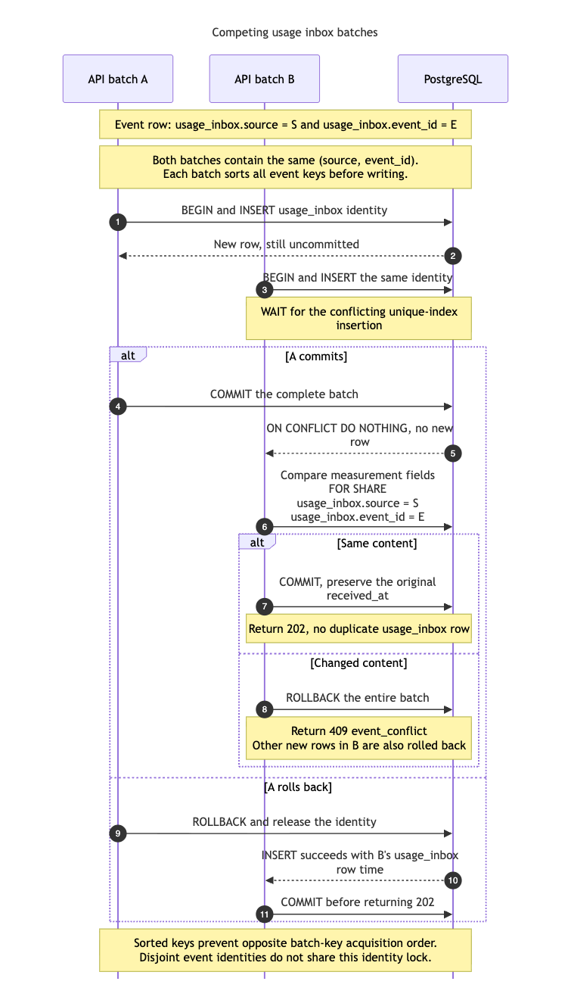

[Full-size PNG](../diagrams/locking-inbox-writers/locking-inbox-writers.png) · [Mermaid](../diagrams/locking-inbox-writers/locking-inbox-writers.mmd)

## usage_inbox row replay versus worker completion

The API holds a share lock on an existing usage_inbox row while comparing its measurement fields; the worker requires an update lock on that same row. Whichever obtains its row lock first makes the other wait. usage_inbox row replay never acquires an account lock, changes `received_at`, resets accounting state or applies financial effects.

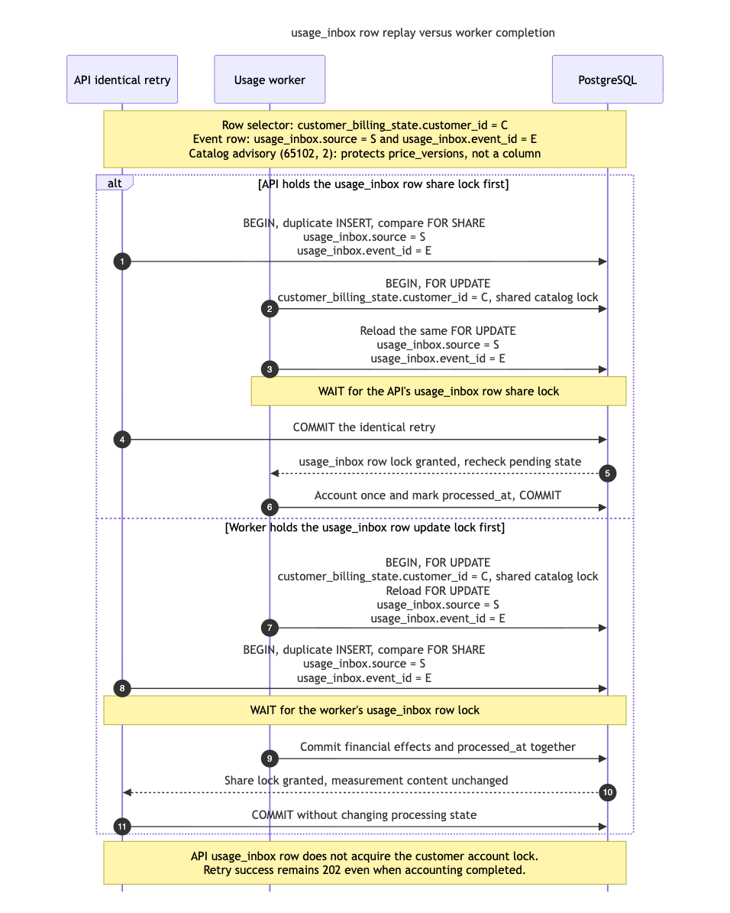

[Full-size PNG](../diagrams/locking-inbox-rating/locking-inbox-rating.png) · [Mermaid](../diagrams/locking-inbox-rating/locking-inbox-rating.mmd)

## Two workers

Candidate selection does not reserve an event: two workers may select the same row. They first serialize on its customer account, then recheck the pending predicate under the usage_inbox row lock. A completed or quarantined usage_inbox row disappears from that predicate, so the follower does not charge it again. If the winner rolls back, the follower can process the still-pending usage_inbox row. Different usage_inbox rows for one customer also serialize, preserving the shared credit balance.

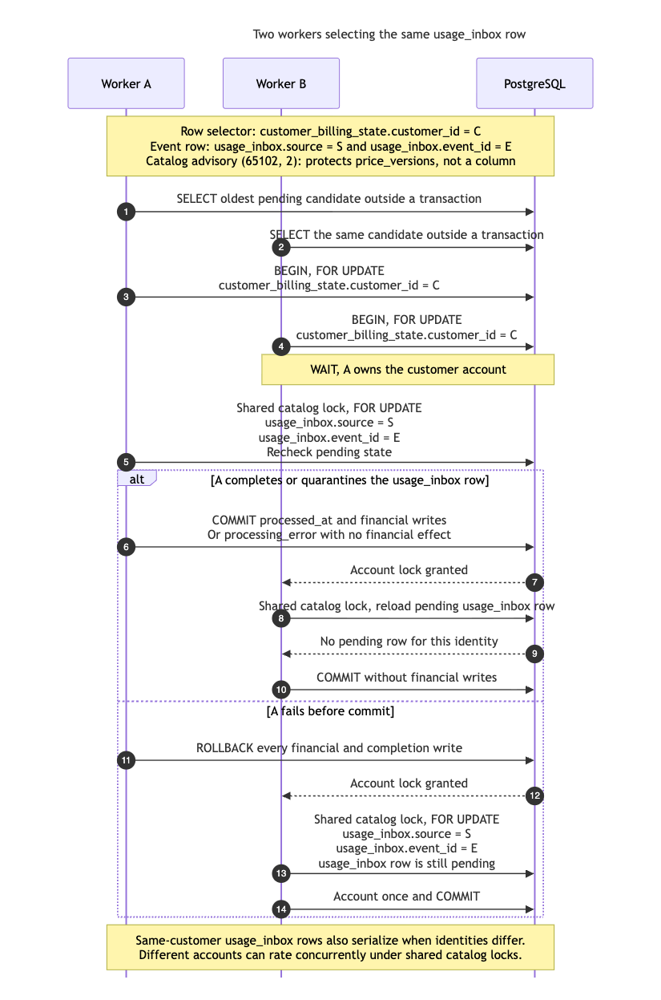

[Full-size PNG](../diagrams/locking-workers/locking-workers.png) · [Mermaid](../diagrams/locking-workers/locking-workers.mmd)

## Worker versus monthly closing

The account lock establishes the invoice cutoff. A worker that commits first contributes its processed group to the eligible original month. A closing transaction that wins first publishes from existing groups; the waiting worker subsequently routes the usage_inbox row forward under the committed closure history. Acceptance before closing does not guarantee inclusion. Both branches preserve original usage-month spend, historical pricing and exactly one credit allocation.

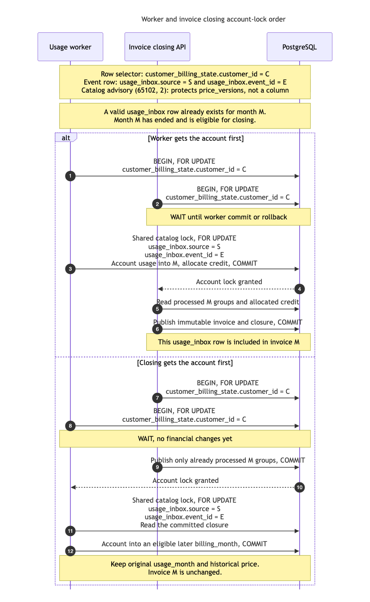

[Full-size PNG](../diagrams/locking-worker-closing/locking-worker-closing.png) · [Mermaid](../diagrams/locking-worker-closing/locking-worker-closing.mmd)

## Financial command replay

The scoped request lock prevents two successful effects for one command key. A follower waits before reading history, then returns the stored result for identical semantic input or `409` for changed input. Replay returns before taking the operation's account or catalog lock. Failed transactions leave neither an effect nor a successful key record. New keys can still contend on the same customer or catalog resource.

Scopes are `prices`, `credits/{customer}`, `spend-limit/{customer}`, `addons/{customer}`, `addon-cancellations/{customer}` and `invoice-catch-up/{customer}`. The same text key in different scopes represents different commands.

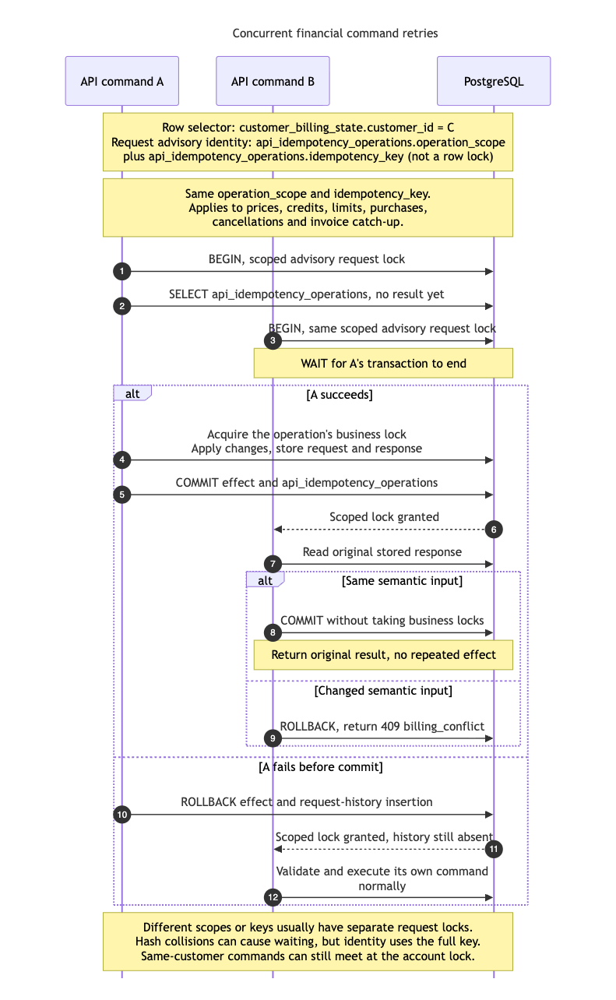

[Full-size PNG](../diagrams/locking-command-replay/locking-command-replay.png) · [Mermaid](../diagrams/locking-command-replay/locking-command-replay.mmd)

## Price insertion versus rating

A price command needs the exclusive catalog lock; workers hold its shared counterpart from before price lookup through accounting commit. Price-first rating sees the newly committed catalog but still selects by consumption time. Worker-first insertion must preserve that committed rating and rejects a proposal that would change its selected version or interval validity. Validation also samples the current UTC day after waiting, so a requested activation can become backdated and return `422` without a write.

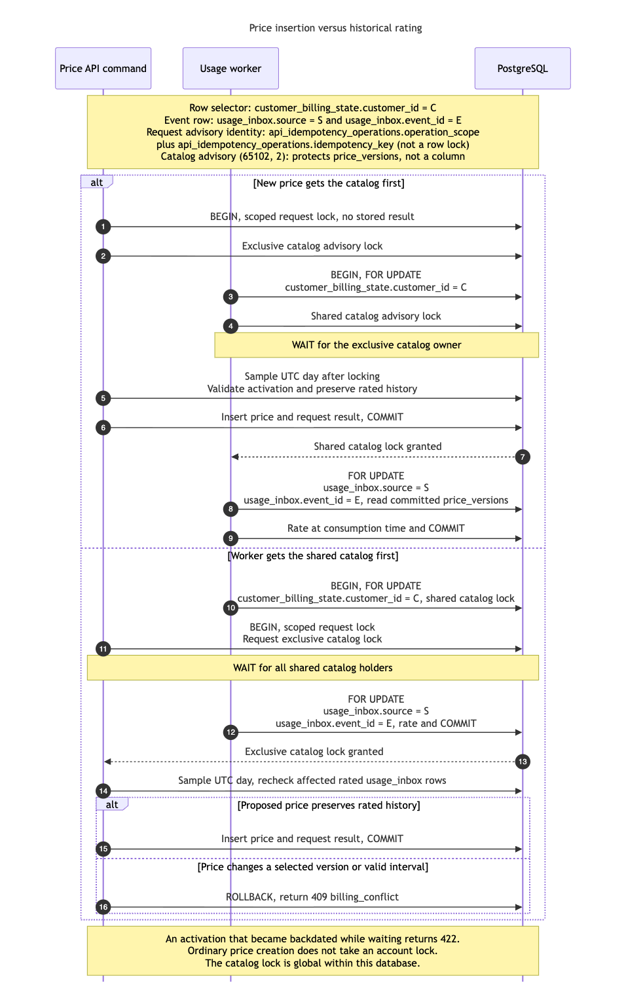

[Full-size PNG](../diagrams/locking-price-rating/locking-price-rating.png) · [Mermaid](../diagrams/locking-price-rating/locking-price-rating.mmd)

## Credit grant versus rating

Credit is available according to account-lock order. With zero initial credit, a 3-cent charge and a 2-cent grant, grant-first accounting allocates 2 cents and leaves 1 cent payable. Worker-first accounting leaves all 3 cents payable; the later 2-cent grant remains available for future accounting. Both operations succeed, but their order changes the allocation. Two distinct grants add rather than overwrite, while identical-key replay grants once.

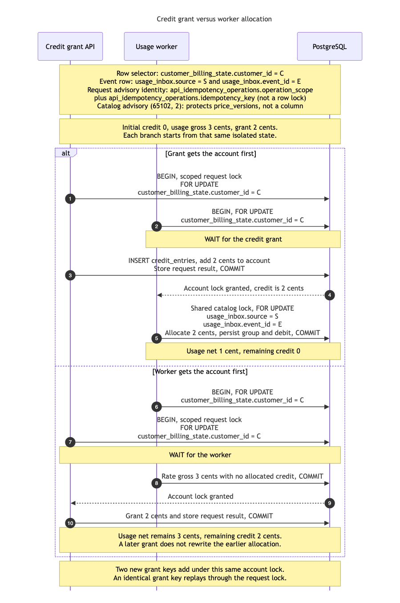

[Full-size PNG](../diagrams/locking-credit-rating/locking-credit-rating.png) · [Mermaid](../diagrams/locking-credit-rating/locking-credit-rating.mmd)

## Spend-limit writes and status reads

Distinct limit commands serialize on the account and the later write sets the final limit. Replaying an earlier key returns its original command result without overwriting a newer configuration. Worker, grant and invoice updates also use this account lock, preventing lost `state_version` increments. A normal status read uses one committed snapshot and can return while the next configuration is uncommitted; it does not reserve or enforce the limit.

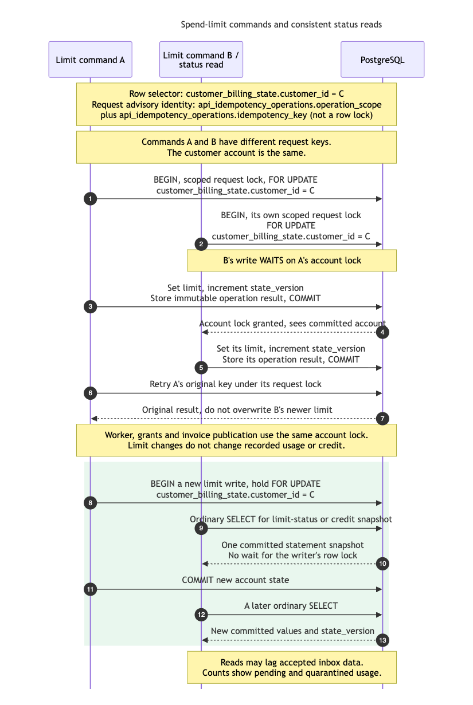

[Full-size PNG](../diagrams/locking-limit-writes/locking-limit-writes.png) · [Mermaid](../diagrams/locking-limit-writes/locking-limit-writes.mmd)

## Add-on purchase versus closing

If a same-month purchase wins the account first, closing includes its full stored monthly price. If closing wins, the waiting purchase sees the closure and fails with `409`; it cannot add a fee to the issued invoice. An older purchase that wins before a later first closing also prevents skipping its earlier active month. Competing purchase keys serialize, and the purchase trigger rejects overlapping activation periods with SQLSTATE `23505`.

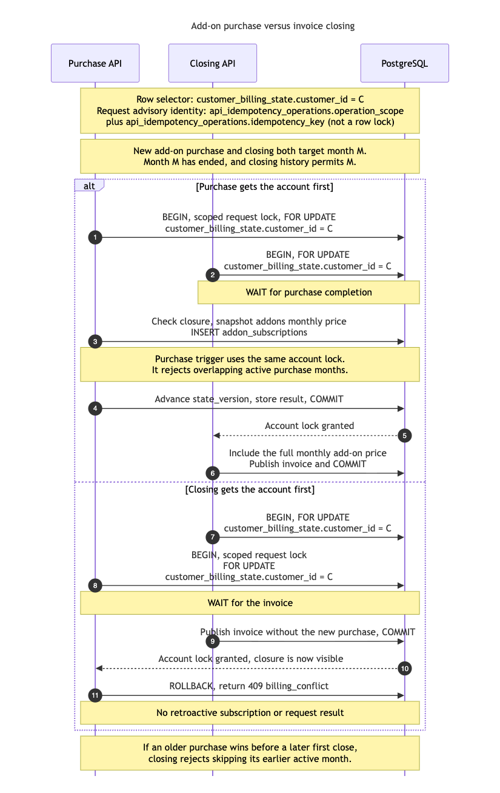

[Full-size PNG](../diagrams/locking-addon-purchase/locking-addon-purchase.png) · [Mermaid](../diagrams/locking-addon-purchase/locking-addon-purchase.mmd)

## Add-on cancellation and reactivation

Cancellation-first closing still charges the cancellation month in full and omits that subscription in later months. Closing-first cancellation for that month fails with HTTP `409`; a direct SQL insertion is rejected by the integrity trigger with SQLSTATE `23514`. Distinct keys cannot cancel one subscription twice; identical-key replay returns the original result. A new purchase uses a fresh identity and must start after the inclusive last billed month; the same-month overlap is rejected.

The triggers acquire the same customer account lock even for direct SQL inserts. They enforce purchase overlap and cancellation-date/closure invariants, while the API also supplies command history, `state_version` updates and purchase closure validation. A trigger does not turn arbitrary direct SQL into an equivalent API command.

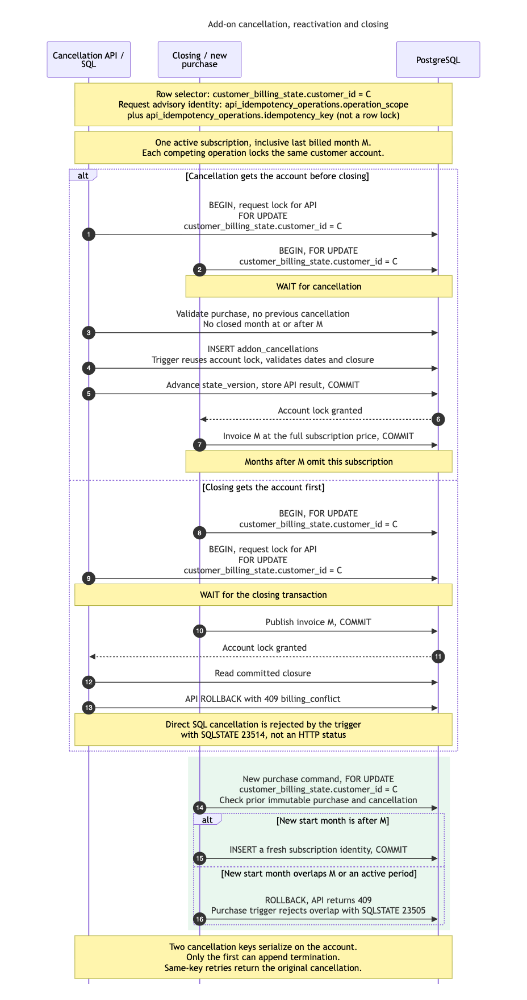

[Full-size PNG](../diagrams/locking-addon-cancel/locking-addon-cancel.png) · [Mermaid](../diagrams/locking-addon-cancel/locking-addon-cancel.mmd)

## Concurrent monthly closing

Two requests for one customer and month serialize on the account. After the winner commits, the follower reads the same immutable snapshot and number. A different month is checked against the new closure history; a missing predecessor or backward close fails with `409`. Before-commit publication failure rolls back the closure, snapshot, group links and counters, allowing a waiting request to try normally. A lost response after commit is resolved by replaying customer and month.

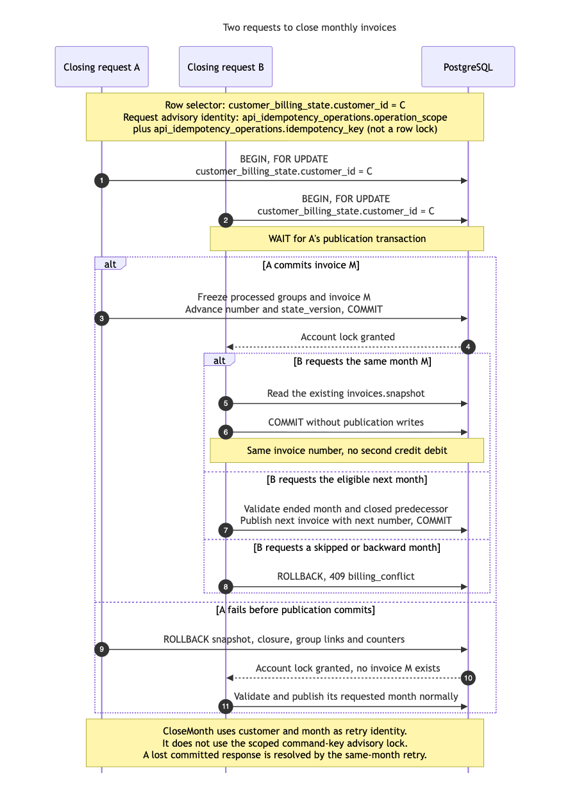

[Full-size PNG](../diagrams/locking-invoice-requests/locking-invoice-requests.png) · [Mermaid](../diagrams/locking-invoice-requests/locking-invoice-requests.mmd)

## Catch-up versus worker and single-month closing

Catch-up holds the account lock through the complete chronological range and publishes the range with its command result in one transaction. A waiting worker sees all committed closures and routes forward; a waiting close for an already recovered month returns its original invoice. A worker that commits first can still enter the original open month. A single close that attempts to skip an unclosed predecessor fails before catch-up recovers the missing range. Same-key catch-up returns the original range, even after later invoices exist.

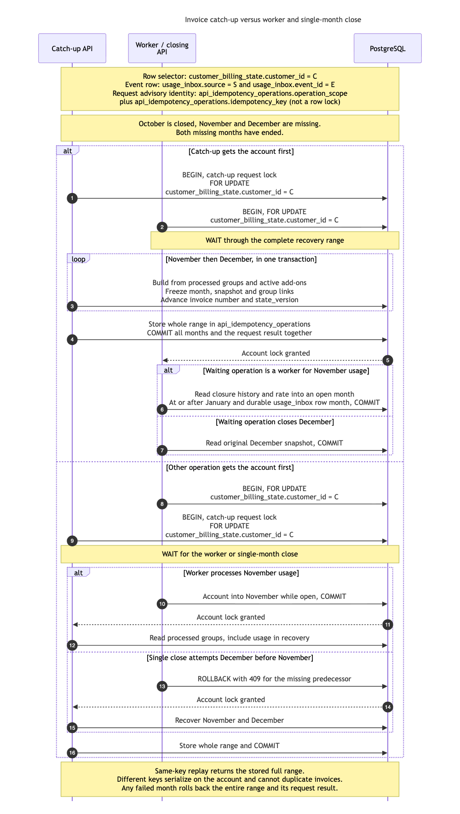

[Full-size PNG](../diagrams/locking-catchup/locking-catchup.png) · [Mermaid](../diagrams/locking-catchup/locking-catchup.mmd)

## Historical catalog repair

The [controlled SQL procedure](../guides/accounting-recovery.md#controlled-historical-price-repair) locks the investigated account before requesting exclusive catalog access. Other customers' shared catalog holders can delay the repair; account-first order prevents same-customer accounting from passing it. The repair checks rated history before committing the historical price and explicit usage_inbox row release together. Closing can still win after release and before accounting: release makes a usage_inbox row pending, not processed. A quarantined event can only become a new worker candidate after release commits.

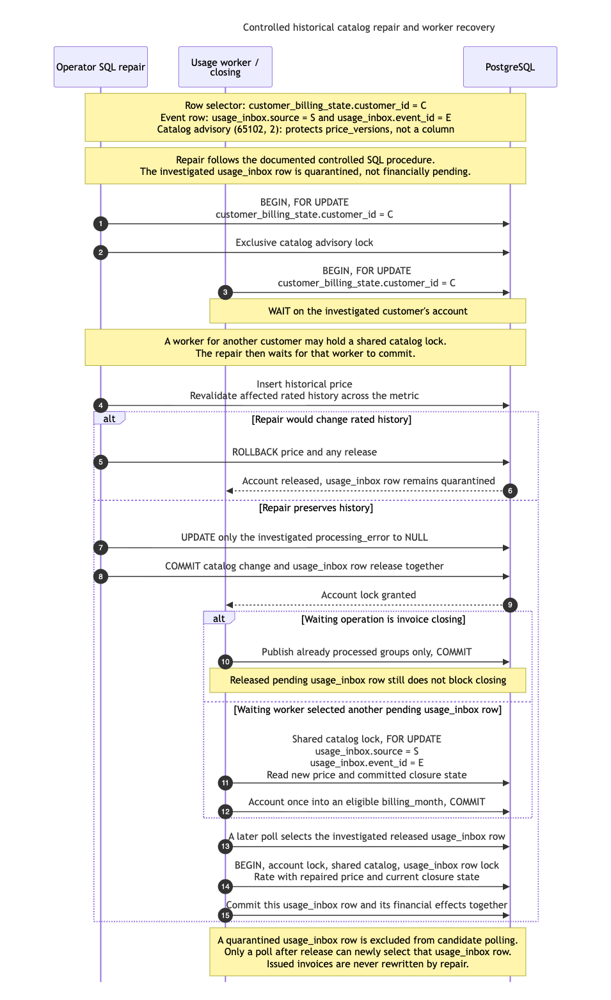

[Full-size PNG](../diagrams/locking-catalog-repair/locking-catalog-repair.png) · [Mermaid](../diagrams/locking-catalog-repair/locking-catalog-repair.mmd)

## Concurrent migration runners

The second runner waits before creating or inspecting `schema_migrations`. After a successful commit it skips the recorded versions; after rollback it can apply the still-missing changes. Schema changes and their records share one transaction. This migration lock coordinates runners, while PostgreSQL's normal DDL locks determine interference with live application queries; the distinct catalog advisory key does not provide online migration safety.

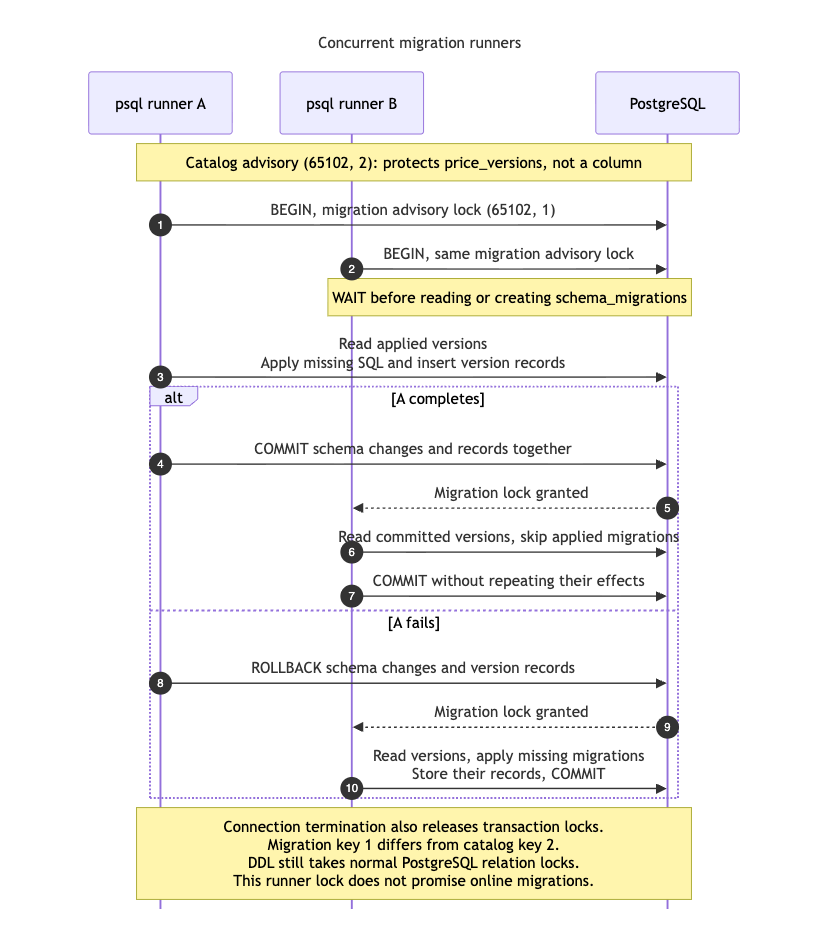

[Full-size PNG](../diagrams/locking-migrations/locking-migrations.png) · [Mermaid](../diagrams/locking-migrations/locking-migrations.mmd)

## Simulator checkpoint ownership

Only one simulator process can own a given state path. A competing command gets an immediate nonblocking file-lock error and does not load or modify the checkpoint through that store. Normal exit and process termination release ownership. Atomic replacement and file/directory synchronization preserve a complete old or new checkpoint. Event identities survive recovery, so database replay remains safe even if usage_inbox row acknowledgement preceded a checkpoint failure.

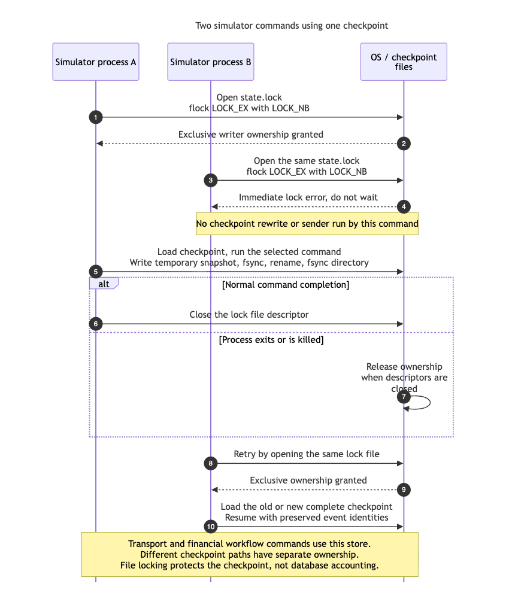

[Full-size PNG](../diagrams/locking-simulator-state/locking-simulator-state.png) · [Mermaid](../diagrams/locking-simulator-state/locking-simulator-state.mmd)

## API admission capacity

The usage handler admits a bounded number of simultaneous requests with a nonblocking channel slot. If all slots are occupied, another request returns `503 inbox_unavailable` with `Retry-After: 1` before parsing the body or accessing PostgreSQL. An admitted request retains its slot until handler completion. Producer retries preserve identities and content. This process-local capacity control complements the database locks; separate API processes have separate admission budgets.

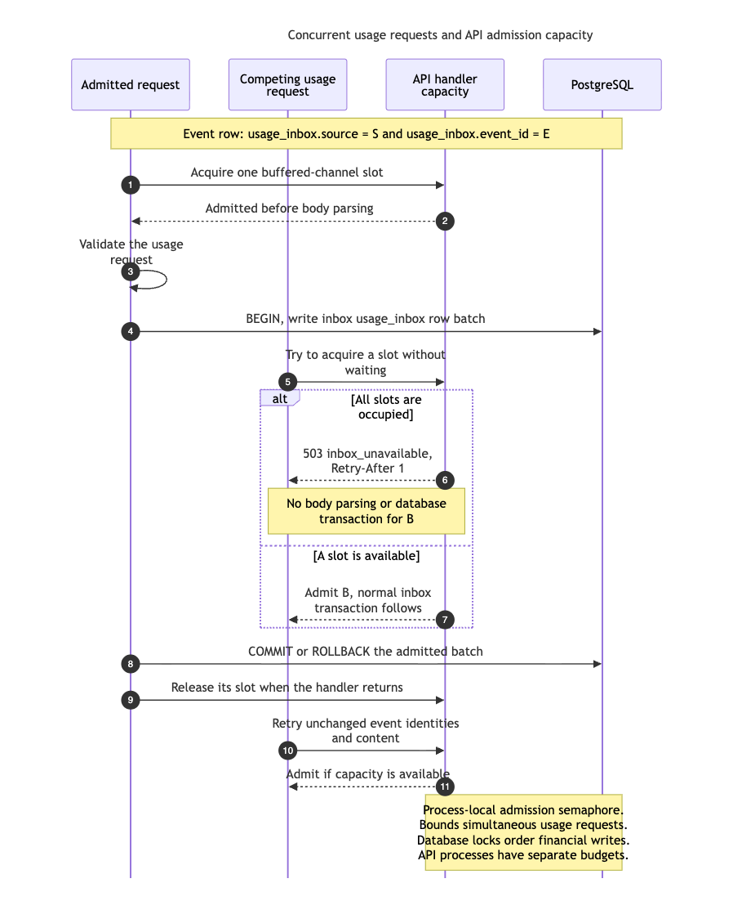

[Full-size PNG](../diagrams/locking-usage-admission/locking-usage-admission.png) · [Mermaid](../diagrams/locking-usage-admission/locking-usage-admission.mmd)

## Transaction completion and failures

Every illustrated database owner releases its locks at commit or rollback, including rollback after a cancelled operation. The storage wrapper bounds cleanup independently of the cancelled request. A database failure makes worker accounting roll back and retry after the polling interval; a domain error commits quarantine with no financial effect. A command failure returns its appropriate error and leaves no successful request-history entry. Ambiguous commit outcomes require unchanged command or usage_inbox row retry identities.

The diagrams describe explicit application coordination. PostgreSQL also acquires implicit row, index, relation and foreign-key locks while executing these writes; those mechanisms do not add a separate billing transaction. Acquiring an arbitrary set of locks through ad hoc SQL can produce different wait relationships. The described invariants rely on the operation-specific account, catalog, usage_inbox row and request ordering shown above.

## Deadlock and blocking assessment

**The supported API and worker paths have no lock-order cycle identified under a fixed schema and the documented SQL discipline.** This is a scoped code review and regression result, not a proof covering arbitrary SQL or all future changes. **Two unsafe maintenance orders reproduce PostgreSQL deadlocks, and the oldest-event polling strategy reproduces cross-customer blocking.** A deadline limits an attempt; repeated attempts can still leave another customer's work waiting indefinitely.

### Findings by sequence

| Sequences | Finding and consequence | Implemented protection or recommended action |
| --- | --- | --- |
| Competing inbox batches; row replay versus completion | Shared-row checks can delay a worker through the entire batch. The worker then holds its customer row and shared catalog advisory while waiting. Sorted `(usage_inbox.source, usage_inbox.event_id)` acquisition prevents opposite batch-key order; ingestion does not request customer rows. No reverse edge to the customer lock was found. | Keep sorted keys and atomic batch semantics. Tune batch size from measured lock-hold time; changing `FOR SHARE` to a plain read requires proving immutable measurement fields and concurrent retry semantics. |
| Two workers; worker versus closing | Ordinary same-customer serialization is required for credit and the invoice cutoff. However, every worker currently polls the single global oldest pending key before requesting `customer_billing_state.customer_id`. If that customer is blocked, all such loops can repeatedly select it while another customer's event is ready. | **Reproduced:** blocked oldest `acme` leaves both customers pending until timeout; blocking only later `cyberdyne` lets `acme` complete. Proposal: select an eligible customer before its oldest event, retaining customer-first locking and per-customer ordering. Increasing worker count alone does not solve it. |
| Financial command replay | One request advisory is acquired before any customer/catalog business resource. Each supported transaction takes one such request identity, so no reverse request-lock dependency was found. Equal hash values for distinct identities can cause unnecessary waiting but do not merge replay identities. | Retain full primary-key comparison in `api_idempotency_operations`. Consider a wider stable advisory hash only after measuring collision pressure; this would still not eliminate all possible hash collisions. |
| Price insertion versus rating | The catalog advisory `(65_102, 2)` is global. A price change for one metric/customer can delay every rater. Workers request their customer row before the shared catalog advisory, so that wait also delays credit, limits, add-ons and closing for those customers. `preserveRatedHistory` loads affected events and reloads prices per event under the exclusive advisory; work is not bounded by a fixed row count. | Proposal: cache relevant price lists within the transaction and reduce repeated queries while keeping the exclusive-lock history check atomic. Then evaluate metric-scoped catalog resources with an explicit order for repair of multiple metrics; account-specific locks alone do not protect default prices. |
| Credit versus rating; limit writes and reads | Customer-row serialization is financially meaningful. A later grant must not rewrite earlier allocation; a later limit command must not be undone by old-key replay. Normal credit and limit reads use one committed statement snapshot and do not wait for these row locks. | Preserve the shared customer invariant. Observe pool acquisition time separately from PostgreSQL lock wait: a read can still queue for a connection occupied by blocked writes. `/healthz` does not access PostgreSQL and can remain healthy during that condition. |
| Add-on purchase/cancellation and closing | API calls take request identity then customer row. The insertion triggers reuse the same customer row; no reverse edge between subscription/cancellation checks and that row was found for the supported inserts. Direct SQL does not supply all API validation, request history or version changes. | Keep trigger checks and immutable periods. Do not introduce independent subscription-first locks before the customer row without a new cycle review. Existing forced-winner scenarios verify inclusion, cancellation and overlap rejection. |
| Monthly closing; catch-up | Closing materializes all relevant groups and invoice JSON while holding the customer row. Catch-up holds it for up to 12 months in one transaction. The month count is bounded, but group counts and snapshot size are not capped by that limit. | Proposal: measure groups, bytes, SQL calls and customer lock duration. Cache immutable buyer/add-on facts within a catch-up transaction where semantics permit. Splitting the recovery transaction would change its all-or-nothing contract and is not a behavior-preserving optimization. |
| Historical repair | The documented order is customer row then exclusive catalog advisory. Taking the catalog first and then the customer row forms a cycle with a worker holding the customer row and waiting for shared catalog access. An interactive session can also keep these resources held while its operator pauses. | **Reproduced SQLSTATE `40P01`** for the reversed order; the documented order completes. Keep the documented order, prepare review input before `BEGIN`, commit/rollback promptly, and consider session-local wait/statement/idle-transaction limits. Those limits are proposals, not installed settings. |
| Migration/DDL maintenance | The migration advisory `(65_102, 1)` only serializes runners. Relation locks can produce a separate cycle: maintenance holds `usage_inbox` in `SHARE ROW EXCLUSIVE`, then requests `customer_billing_state` in `ACCESS EXCLUSIVE`; a worker holds the account relation and needs `ROW EXCLUSIVE` for its final `usage_inbox.processed_at` update. | **Reproduced SQLSTATE `40P01`** in a controlled relation-lock simulation on the real worker. This is not a claim that every migration run deadlocks. Follow the existing stop-API/worker upgrade procedure; quiesce all writers for DDL and inspect the specific migration's relation-lock order. |
| Simulator file ownership; API admission | The simulator rejects a second owner without waiting. One simulator can hold the file while waiting on HTTP/backoff, but there is no database transaction that then requests this file, so no cross-resource cycle was found. API admission is process-local and only applies to usage requests. | Keep exclusive checkpoint ownership. Use genuinely separate state files for independent producers. Consider admission for financial writes and separate read budgets if pool occupancy becomes a problem; more connections alone can create more waiting writers. |

### Reproduced unsafe cycles

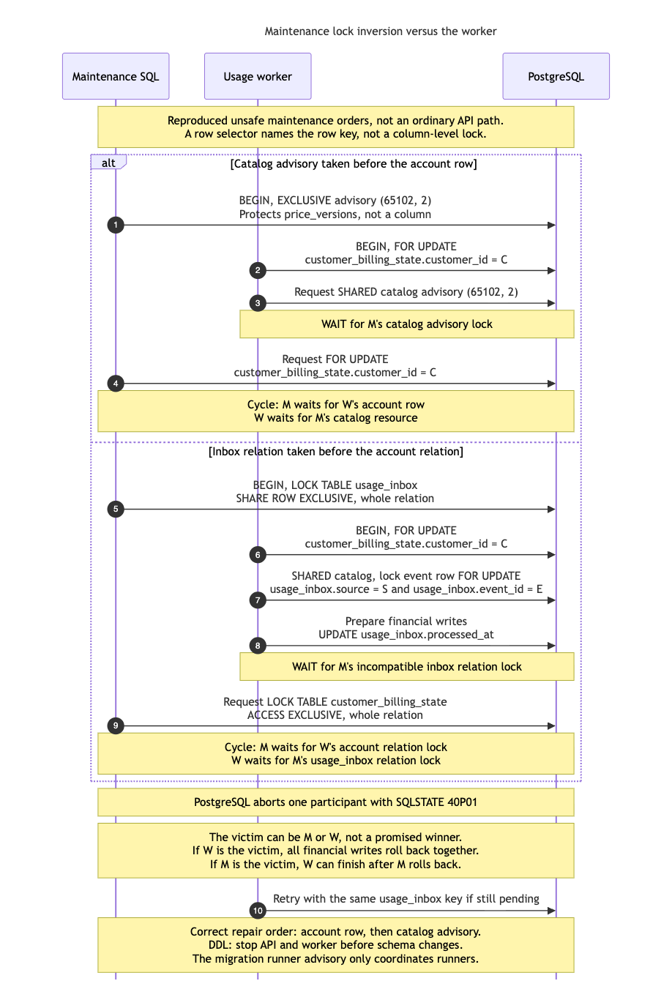

[Full-size PNG](../diagrams/locking-maintenance-deadlock/locking-maintenance-deadlock.png) · [Mermaid](../diagrams/locking-maintenance-deadlock/locking-maintenance-deadlock.mmd)

The tests use a private schema, the real `ProcessBatch`, observed blocked statements and explicit maintenance locks. For each cycle PostgreSQL reports one `40P01`; the test permits either participant to be the victim. If the worker is aborted, groups, credit debit, monthly totals and completion roll back together. An unchanged-key retry then accounts exactly once. The adjacent forward-order scenarios complete without a deadlock. PostgreSQL detects a cycle and aborts a participant; the victim is not an application scheduling guarantee. [PostgreSQL 18 locking and deadlocks](https://www.postgresql.org/docs/18/explicit-locking.html#LOCKING-DEADLOCKS).

The relation-lock test models incompatible DDL locks; it does not run the full migration chain against live traffic. `SELECT ... FOR UPDATE` takes a `ROW SHARE` relation lock in addition to its row lock, while `UPDATE` requests `ROW EXCLUSIVE`. Those modes explain the reproduced maintenance cycle. [PostgreSQL 18 relation-lock conflicts](https://www.postgresql.org/docs/18/explicit-locking.html#LOCKING-TABLES).

### Reproduced oldest-customer blocking

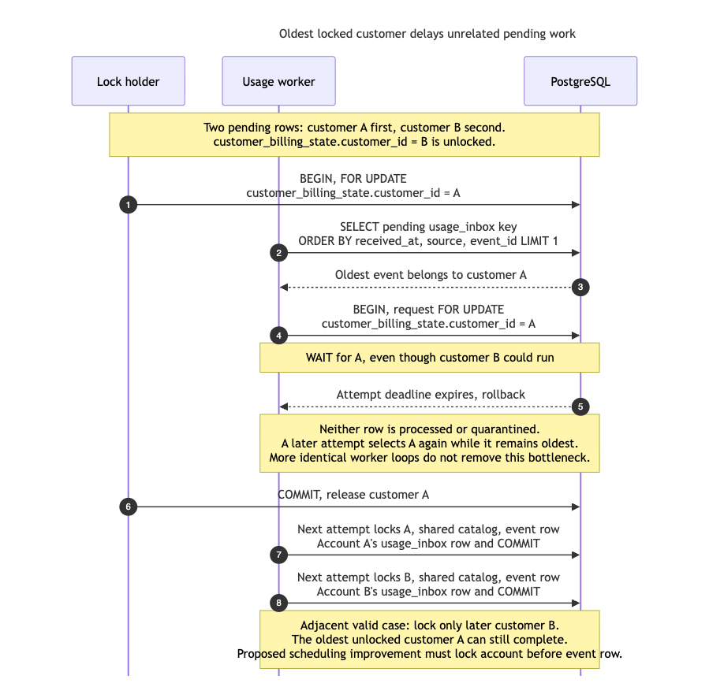

[Full-size PNG](../diagrams/locking-oldest-customer/locking-oldest-customer.png) · [Mermaid](../diagrams/locking-oldest-customer/locking-oldest-customer.mmd)

This is a scheduling bottleneck, not a deadlock: one owner prevents progress and the worker has no cycle back to it. The exceptional outcome and adjacent valid case both preserve credit, absence of quarantine and exact eventual gross amounts after the owner releases its lock. A future scheduler could try-lock or skip locked **customer rows**, then select the oldest pending event for an acquired customer. Locking/skipping event rows first would invert the current customer-before-event order and could change credit allocation order. The proposal therefore needs explicit per-customer ordering, starvation and cutoff tests before adoption.

### Deadlines and observability

The configured defaults are a 10-second API operation budget, a 5-second worker batch budget and 5-second rollback cleanup budget. The API budget is also used for financial operations, although its environment name is `E2B_API_INGESTION_TIMEOUT`. Worker retries wait for the 1-second polling interval after failure. Pool acquisition, lock waits, queries and commit share their operation context; these are not independent fresh budgets for each statement. Cancellation requests cleanup, but does not guarantee that every server lock disappears at an exact wall-clock instant. Direct storage calls depend on their caller's context.

The application does not itself configure `lock_timeout`, `statement_timeout` or `idle_in_transaction_session_timeout`. PostgreSQL's default zero values disable those server limits, so an interactive maintenance transaction can outlive an API attempt. A statement or lock timeout inside a manual transaction still requires rollback; an idle-transaction timeout terminates an idle transaction's session. Proposed session-local limits must be coordinated with caller deadlines and connection cleanup, rather than described as present safeguards. [PostgreSQL 18 connection and timeout settings](https://www.postgresql.org/docs/18/runtime-config-client.html#RUNTIME-CONFIG-CLIENT-STATEMENT).

Separate lock waiting from slow computation, large snapshots, WAL flush and pool waiting. Useful measurements are blocking backend IDs, current statement, transaction age, request scope, customer key, group counts, snapshot bytes, pool occupancy and query duration. `pg_blocking_pids` and `pg_stat_activity` expose blocking relationships; `pg_locks` identifies actual granted and awaited modes. [PostgreSQL 18 lock inspection](https://www.postgresql.org/docs/18/view-pg-locks.html). Never interpret `deadlock_timeout` as a maximum lock wait; it controls when PostgreSQL checks for a cycle. [PostgreSQL 18 lock-management settings](https://www.postgresql.org/docs/18/runtime-config-locks.html).

### Prioritized improvement proposals

1. Keep the documented SQL order and existing quiesced-migration procedure; add bounded interactive maintenance policies and a lock-wait diagnostic runbook.
2. Remove the cross-customer oldest-event bottleneck with an account-first scheduler while preserving per-customer event order and the invoice cutoff.
3. Reduce repeated price-history queries under the global catalog advisory; measure its hold time before changing resource scope.
4. Measure and reduce catch-up materialization work inside the existing atomic transaction. Do not silently split the invoice publication invariant.
5. Add bounded financial-command admission and independent read capacity if lock waits consume the shared API pool. Treat connection increases as a measured capacity change, not a deadlock fix.

These are unimplemented proposals. No runtime lock order, API response, retry identity, financial rule or transaction boundary is changed by this documentation and its regression scenarios.

## Implementation and executable scenarios

| Responsibility | Implementation | Regression scenarios |
| --- | --- | --- |
| usage_inbox row identity, sorting and share locks | [Inbox storage](../../internal/postgres/usage.go) | [Identical/conflicting batches and waiting writers](../../tests/inbox/usage_inbox_test.go). |
| Account and catalog boundaries | [Lock helpers](../../internal/postgres/financial_storage.go), [worker transaction](../../internal/postgres/processor.go) | [Concurrent workers and complete financial rollback](../../tests/inbox/billing_test.go), [both worker/closing lock winners](../../tests/inbox/processed_closing_test.go). |
| Scoped replay | [Operation history](../../internal/postgres/idempotency.go) | [Credit/limit races and replay](../../tests/inbox/command_idempotency_test.go), [price/purchase races](../../tests/inbox/resource_idempotency_test.go), [cancellation races](../../tests/inbox/addon_cancellation_concurrency_test.go). |
| Credit/rating and price/rating order | [Grants](../../internal/postgres/credit.go), [price commands](../../internal/postgres/prices.go) | Forced winners with literal financial expectations in `tests/inbox/locking_concurrency_test.go`, registered under [TestGrantCredit](../../tests/inbox/credit_test.go) and [TestCreatePrice](../../tests/inbox/prices_test.go). |
| Price time boundaries | [Historical rating](../../internal/accounting/pricing.go) | [UTC day sampled after a catalog wait](../../tests/inbox/price_activation_test.go), [valid boundaries and unsupported crossing](../../tests/inbox/price_boundary_test.go). |
| Limit snapshots and configuration | [Limits](../../internal/postgres/limits.go) | [Replay and newer configuration](../../tests/inbox/limits_test.go), [command contention](../../tests/inbox/command_idempotency_test.go). |
| Add-on period protection | [Purchase](../../internal/postgres/addons.go), [cancellation](../../internal/postgres/addon_cancellations.go), [integrity triggers](../../migrations/013_addon_cancellations.sql) | [Forced purchase/closing order](../../tests/inbox/addon_closing_test.go), [forced cancellation/closing order](../../tests/inbox/addon_cancellation_concurrency_test.go), [SQL integrity](../../tests/sql/addon_lifecycle.sql). |
| Monthly publication and recovery | [Closing](../../internal/postgres/invoices.go), [catch-up](../../internal/postgres/invoice_catchup.go) | [Invoice replay and rollback](../../tests/inbox/invoices_test.go), [catch-up races and boundaries](../../tests/inbox/invoice_catchup_boundaries_test.go). |
| Historical repair | [Repair procedure](../guides/accounting-recovery.md) | [Recovery after closure](../../tests/inbox/delayed_price_test.go), [quarantine has no charges](../../tests/inbox/quarantined_closing_test.go). |
| Migration serialization | [Runner](../../migrations/migrate.sql) | [Fresh and repeated concurrent runners with restart](../../tests/e2e/migrations_test.go). |
| Simulator ownership | [Checkpoint store](../../internal/simulator/store.go) | [Competing owners and killed-process release](../../internal/simulator/store_test.go). |
| Admission and deadlines | [Usage handler](../../internal/httpapi/usage.go), [transaction cleanup](../../internal/postgres/transactions.go) | [Handler admission scenarios](../../internal/httpapi/handler_test.go), [worker retry lifecycle](../../internal/worker/worker_test.go). |

These sequences explain the implemented behavior; they do not change runtime contracts. The linked tests cover the financial outcomes and boundaries stated above. [Maintenance-cycle and blocked-oldest-customer scenarios](../../tests/inbox/locking_risks_test.go) are registered under `TestProcessBatch`; they cover both unsafe cycles, adjacent safe orders, rollback, unchanged-key recovery and independent-customer progress. Not every drawn cross-operation wait is forced in a dedicated test; for example the ordinary usage_inbox row-share-lock/worker-update interaction and the ordinary-read MVCC example also follow directly from the displayed PostgreSQL statements. The guide identifies executable evidence without claiming that every possible pair of operations is exhaustively interleaved.
