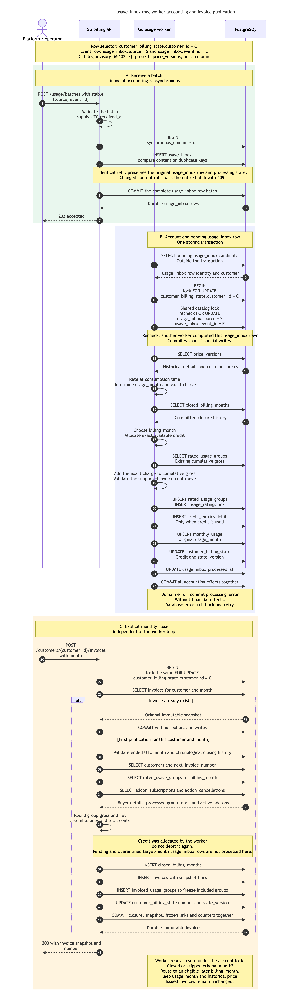

# Usage processing and invoice sequence diagrams

The implemented path has three separate transaction boundaries: the API accepts measurements into `usage_inbox`, the worker rates each pending usage_inbox row and stores its financial effects, and an explicit closing request publishes an immutable invoice. Start with the sequence below to see the owners, table writes and ordering together.

`rated_usage_groups` stores accumulated results. The worker calculates the historical price, exact charge and credit allocation in Go; the table does not run the calculation. Closing reads those results and builds invoice lines. It never starts the worker or drains the inbox.

## Complete implemented sequence
<

[Open the full-size PNG](../diagrams/usage-invoice-sequence/usage-invoice-sequence.png) · [Editable Mermaid source](../diagrams/usage-invoice-sequence/usage-invoice-sequence.mmd)

The caller lane represents the platform during usage_inbox row and the operator during closing. The worker polls PostgreSQL independently; there is no API-to-worker handoff call. The colored phases show a successful accounting run followed by closing, not a requirement that all accepted usage_inbox rows finish before closing. Each worker transaction handles one usage_inbox row. The same customer account lock serializes financial processing and invoice publication.

| Phase and owner | Reads and calculation | Durable writes, in execution order |
| --- | --- | --- |
| A. Billing API receives a batch | Validate measurement fields; compare existing content for `(source, event_id)`. Supply explicit UTC `received_at`. | Insert new `usage_inbox` rows; commit the entire batch before `202 accepted`. Identical retries preserve existing rows. Changed content returns `409 event_conflict` and rolls back all new rows in the batch. |
| B. Usage worker accounts for one usage_inbox row | Select a pending candidate; begin a transaction; lock `customer_billing_state`, acquire the shared catalog lock and recheck the usage_inbox row. Read `price_versions`, `closed_billing_months` and any existing group. Calculate the historical charge, billing month, exact credit allocation and cumulative gross microcents; validate the invoice-cent range. | Upsert `rated_usage_groups`; insert its `usage_ratings` usage_inbox row link; insert a `credit_entries` debit if credit was used; upsert `monthly_usage`; update account credit and `state_version`; set `usage_inbox.processed_at`; commit together. |
| C. Billing API closes a month | Under the same account lock, return an existing snapshot or validate the ended UTC month and closing order. Read buyer details, rated groups for `billing_month`, subscriptions and cancellations. Assemble the invoice using already allocated credit. | Insert `closed_billing_months`, then `invoices`, then `invoiced_usage_groups`; advance `next_invoice_number` and `state_version`; commit together before returning `200`. |

Groups combine the same customer, price version, original `usage_month` and assigned `billing_month`; the price version fixes the metric. Charges and allocated credit remain exact integer microcents, where `1 cent = 1_000_000 microcents`. The worker stores exact group totals and validates their supported invoice-cent range without persisting a rounded projection. Closing calculates each group's gross and net cents using half-up rounding; displayed credit is rounded gross minus rounded net. Active add-ons use their stored monthly prices and are not reduced by usage credit. Lines live in `invoices.snapshot.lines`; there is no separate invoice-line table.

Pending and quarantined usage_inbox rows in the target month do not block its invoice. If the original usage month is still eligible, delayed accounting stays in it. If that month is closed or has been skipped by later closure, `billing_month` is the later of the usage_inbox row's UTC month and the month after the latest closure. `usage_month` and historical pricing remain unchanged, so late October usage still contributes to October spend status even when invoiced later. The first invoice cannot skip earlier known usage or add-on months; subsequent invoices require a closed predecessor.

Domain failures are quarantined by committing `processing_error` without financial effects; missing valid prices are reported as P0 after that commit. Database failures roll back for retry. A failed invoice publication leaves its transactional closure, snapshot, frozen-group links and counters unchanged; an ambiguous commit outcome must be resolved by retrying the same customer and month.

Implementation references: [usage_inbox row persistence](../../internal/postgres/usage.go), [worker accounting and write order](../../internal/postgres/processor.go), [month selection](../../internal/accounting/calendar.go), [closing transaction](../../internal/postgres/invoices.go), [closing validation](../../internal/postgres/closing.go), [invoice facts](../../internal/postgres/invoice_data.go), [invoice publication](../../internal/postgres/invoice_snapshot.go) and [pure invoice presentation](../../internal/billing/invoice_lines.go).

## Existing diagrams to read alongside the sequence

Each entry links to the editable source and its rendered preview. These views describe the implementation unless explicitly labeled as proposals.

| Diagram and type | What it explains | Links |
| --- | --- | --- |
| Usage to invoice — flowchart | The simplest three-phase view, with exact arithmetic from 1_000 measurements through groups, credit and a USD 0.03 invoice. | [Guide](usage-to-invoice.md), [PNG](../diagrams/usage-to-invoice/usage-to-invoice.png), [Mermaid](../diagrams/usage-to-invoice/usage-to-invoice.mmd) |
| Usage ingestion and retry — sequence | A lost `202` response, identical retries, changed-content conflicts and separate worker accounting. Acceptance says that usage_inbox rows are durable. | [PNG](../diagrams/usage-ingestion/usage-ingestion.png), [Mermaid](../diagrams/usage-ingestion/usage-ingestion.mmd) |
| Closing and late usage — sequence | The assignment's Acme invoices, historical pricing, credit consumed once and late October usage billed in November. | [PNG](../diagrams/invoice-closing/invoice-closing.png), [Mermaid](../diagrams/invoice-closing/invoice-closing.mmd) |
| Spend limit status — sequence | usage_inbox row versus committed accounting, separate status queries, a limit increase and the new UTC month. Reads expose exact gross usage, month, version and backlog counts. | [PNG](../diagrams/limit-status/limit-status.png), [Mermaid](../diagrams/limit-status/limit-status.mmd) |
| One usage_inbox row accounting — flowchart | Detailed account-first locking, group writes, credit allocation, rounding and quarantine, including P0 reporting. | [Explanation](usage-to-invoice.md), [PNG](../diagrams/usage-worker-accounting/usage-worker-accounting.png), [Mermaid](../diagrams/usage-worker-accounting/usage-worker-accounting.mmd) |
| Invoice generation — simplified and detailed flowcharts | Closing validation, processed-group presentation, immutable snapshots and publication failures. | [Simplified PNG](../diagrams/closing-workflow/closing-workflow.png), [simplified Mermaid](../diagrams/closing-workflow/closing-workflow.mmd), [detailed explanation](../diagrams/invoice-issuance/README.md), [detailed PNG](../diagrams/invoice-issuance/invoice-issuance.png), [detailed Mermaid](../diagrams/invoice-issuance/invoice-issuance.mmd) |
| Price activation and delayed delivery — flowchart | Historical price selection, command replay, no ordinary backdating and controlled SQL recovery after quarantine. | [PNG](../diagrams/price-version-activation/price-version-activation.png), [Mermaid](../diagrams/price-version-activation/price-version-activation.mmd) |
| Asynchronous processing — sequence, option D proposal | Kafka redelivery after a financial commit and before offset acknowledgement. Kafka, delta identities and its outbox are proposed components. | [PNG](../diagrams/async-processing/async-processing.png), [Mermaid](../diagrams/async-processing/async-processing.mmd) |

The [implemented schema ERD](../diagrams/implemented-data-model/implemented-data-model.png) and its [source](../diagrams/implemented-data-model/implemented-data-model.mmd) complement the sequences with columns and keys. The [published diagram catalog](../diagrams/index.md) links the selected architecture views and their editable sources.

## Focused sequences and remaining proposals

The [approved vocabulary](../guides/billing-vocabulary.md) defines the names used below. The [concurrency and locking guide](concurrency-and-locking.md) now provides dedicated sequences for all lock-related recommendations below, including worker/closing order, controlled repair, catch-up, competing publications, add-ons, concurrent workers and catalog insertion. The table retains the scenario rationale; scheduling remains a proposal.

The table identifies processes that benefit from dedicated sequences. Lock-related interactions are supplied in the linked guide; the price and interval boundary examples also retain their detailed flowchart and tests. Each sequence focuses on one invariant, using `alt` branches for the competing outcomes.

| Priority | Sequence and scenario focus | Actors, tables and edge cases | Existing partial view or executable scenario |
| --- | --- | --- | --- |
| 1 | Worker versus monthly closing | Two branches under `customer_billing_state FOR UPDATE`: worker commits first and usage enters the original invoice; closing commits first and usage routes forward. Include a usage_inbox row accepted before closing and show that its arrival time alone does not determine inclusion. | [Closing sequence](../diagrams/invoice-closing/invoice-closing.png); [cutoff and lock-order tests](../../tests/inbox/processed_closing_test.go). |
| 2 | Quarantine, operator repair and release | Worker sets `usage_inbox.processing_error` with no group or credit effect; closing succeeds; operator repairs the catalog with controlled SQL and explicitly releases the usage_inbox row; worker processes it into an eligible open month. Show missing-price P0 reporting after commit and preserve historical price and original usage month. | [Price and recovery flowchart](../diagrams/price-version-activation/price-version-activation.png); [recovery tests](../../tests/inbox/delayed_price_test.go), [quarantine tests](../../tests/inbox/quarantined_closing_test.go), [operator procedure](../guides/accounting-recovery.md). |
| 3 | Catch up missing monthly invoices | `POST /customers/{customer_id}/invoices/catch-up`, scoped request lock, account lock and chronological publication in one transaction. Show empty months, recurring add-ons, 12-month limit, rollback of the whole range, identical key replay and conflict on changed content. A waiting worker routes after the entire committed range. | [Delayed billing scenarios](../simulator/delayed-billing.md); [catch-up tests](../../tests/inbox/invoice_catchup_test.go), [boundary and concurrency tests](../../tests/inbox/invoice_catchup_boundaries_test.go). |
| 4 | Lost invoice response and simultaneous closes | Publication commits but HTTP delivery fails; retry reads the same `invoices.snapshot` and number. Compare failure before commit, which rolls back publication, with two callers serialized on the account lock. No second invoice or second credit debit. | [Detailed publication flowchart](../diagrams/invoice-issuance/invoice-issuance.png); [publication rollback and retry tests](../../tests/inbox/invoices_test.go), [cutoff tests](../../tests/inbox/processed_closing_test.go). |
| 5 | Add-on purchase, cancellation and closing | Separate chronological steps for purchase, last billed cancellation month and a fresh subscription. Branch on cancellation winning the account lock versus closing first. Show `addon_subscriptions`, `addon_cancellations`, request replay and immutable invoice lines; the cancellation month costs the full price. | [Lifecycle tests](../../tests/inbox/addon_cancellations_test.go), [competing cancellation and closing tests](../../tests/inbox/addon_cancellation_concurrency_test.go). A dedicated cancellation and reactivation sequence is included in the concurrency guide. |
| 6 | Two workers and a database failure | Both workers select the same pending usage_inbox row, serialize on the account, then recheck `usage_inbox`. The winner commits one rating and credit effect; the follower performs no financial writes. Contrast rollback before commit with a committed usage_inbox row seen after restart; include the worker's retry policy. | [Worker lifecycle](../guides/runtime-configuration.md#worker-lifecycle-and-configuration), [usage_inbox row flowchart](../diagrams/usage-worker-accounting/usage-worker-accounting.png), [accounting concurrency tests](../../tests/inbox/billing_test.go). |
| 7 | Price and UTC interval boundaries | Ordinary price insertion takes the exclusive catalog lock while rating takes the shared lock. Show historical customer overrides and intervals ending exactly at a price or UTC month boundary versus crossing by one microsecond. Crossing is quarantined without charges; the producer must submit valid segments. | [Price flowchart](../diagrams/price-version-activation/price-version-activation.png); [price-boundary tests](../../tests/inbox/price_boundary_test.go), [calendar cases](../../internal/accounting/calendar_test.go). |
| Separate proposal | Automatic monthly generation and delivery | A scheduler calls closing or catch-up, persists progress and retries after interruption; a separate delivery step handles the published invoice. Distinguish invoice existence from delivery acknowledgement. Scheduler, schedule settings and delivery persistence are not implemented. | [Scheduling requirements and proposals](../brainstorming/invoice-scheduling.md), [open contracts](proposed-contracts.md). |

The first three sequences provide the greatest additional clarity: they explain which invoice receives a charge when processing is delayed, how damaged inputs recover without changing an issued invoice, and how an operator recovers missed months. Financial precision is better illustrated by the existing numeric flowchart and rounding examples than by adding more participants to a sequence.

## Regression scenarios for the illustrated contracts

The existing scenarios expose literal expected financial state, not only successful responses. [usage_inbox row tests](../../tests/inbox/usage_inbox_test.go) compare pending, processed and quarantined retries, original arrival timestamps and complete-batch rollback. [Producer recovery](../../tests/inbox/committed_usage_recovery_test.go) exercises a lost real HTTP response and producer termination after commit but before checkpointing. [Closing cutoff tests](../../tests/inbox/processed_closing_test.go) cover zero, partial and complete processing, both account-lock orders, credit used once and separate half-cent rounding when charges land on different invoices. [Price-boundary tests](../../tests/inbox/price_boundary_test.go) check an interval ending exactly at activation, starting exactly at activation and crossing by one microsecond, including unchanged credit and absent financial rows on quarantine.

The documentation portal lists this guide under **Billing → Processing sequences**. Its diagram catalog includes the complete sequence, usage_inbox row retry, late usage, spend status and the explicitly labeled option D proposal. The full local catalog and other working documents remain outside the selected portal content.
